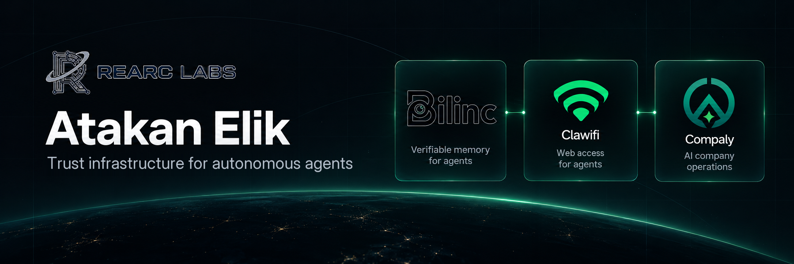

<div align="center">
  
</div>

## Atakan Elik, founder of ReARC Labs

I run [ReARC Labs Inc.](https://rearclabs.com) We build trust infrastructure for autonomous agents: what agents need before they can be trusted to act on their own. Today that is two products: **Bilinc**, verifiable memory for AI agents, and **Clawifi**, web access for AI agents.

ReARC Labs is the team behind Bilinc and Clawifi. It is not related to Rearc (rearc.io).

## Try it

```bash
# Bilinc. Free tier, no card required. The login step opens your browser.
pip install -U bilinc
bilinc login
bilinc quicktest

# Bilinc in Claude Code. You sign in through the browser.
claude mcp add --transport http --scope user bilinc https://mcp.bilinc.space/mcp

# Clawifi in Claude Code. The hosted server works without a key as a trial.
claude mcp add --transport http clawifi https://api.clawifi.dev/mcp

# Clawifi Python client
pip install clawifi
```

Nothing to install: the [Clawifi Playground](https://clawifi.dev/playground) runs with no sign-up.

<table>
<tr>
<td width="50%" valign="top">

### Bilinc

Bilinc is verifiable memory for AI agents, made by ReARC Labs. It is a company brain your agents share: it keeps what they learn current, shows who wrote what, and lets you undo it.

- durable hosted memory with provenance, history and rollback
- Python SDK, CLI and MCP connector, with setup guides for Claude Code, Codex, Cursor, ChatGPT, Claude Desktop and Hermes Agent
- read your agent's memory as a folder of Markdown

[bilinc.space](https://bilinc.space) · [Install Bilinc](https://bilinc.space/install) · [Bilinc on GitHub](https://github.com/atakanelik34/Bilinc) · [Bilinc on PyPI](https://pypi.org/project/bilinc/)

</td>
<td width="50%" valign="top">

### Clawifi

Clawifi is web access for AI agents, made by ReARC Labs. It searches many engines as one, reads pages and PDFs, and gives back the passages that answer the question, each with its source.

- search, fetch, scrape, map, crawl and browse, plus batch jobs and monitors
- hosted remote MCP, Python SDK, CLI and HTTP API
- public beta; the Free plan includes 1,000 credits a month

[clawifi.dev](https://clawifi.dev) · [Clawifi quickstart](https://clawifi.dev/docs/quickstart) · [clawifi-mcp on GitHub](https://github.com/atakanelik34/clawifi-mcp) · [Clawifi on PyPI](https://pypi.org/project/clawifi/)

</td>
</tr>
</table>

## More repos

- [Bilinc Memory History](https://github.com/atakanelik34/bilinc-memory-history) keeps a local history of the memory files Claude Code and Hermes Agent write. See what changed, and put an old version back. Open source, MIT.
- Bilinc plugins: [bilinc-cursor-plugin](https://github.com/atakanelik34/bilinc-cursor-plugin) · [bilinc-claude-plugin](https://github.com/ReARCLabs/bilinc-claude-plugin) · [bilinc-hermes-plugin](https://github.com/ReARCLabs/bilinc-hermes-plugin)
- Clawifi plugin: [clawifi-claude-plugin](https://github.com/ReARCLabs/clawifi-claude-plugin)

Also at ReARC Labs: Compaly, AI company operations, is in development. ARES Protocol, an identity for each agent and a public record of what it did, is paused.

<p>
  <a href="https://pepy.tech/projects/bilinc">
    
  </a>
  <a href="https://pypi.org/project/bilinc/">
    
  </a>
  <a href="https://pypi.org/project/clawifi/">
    
  </a>
  
</p>

## Elsewhere

[Atakan Elik on X](https://x.com/AtakanElik_) · [Atakan Elik on LinkedIn](https://www.linkedin.com/in/atakanelik) · [ReARC Labs on GitHub](https://github.com/ReARCLabs) · [ReARC Labs on X](https://x.com/rearclabs) · [ReARC Labs on LinkedIn](https://www.linkedin.com/company/rearclabs)

---

<div align="center">
  <sub>Agents should leave receipts. Systems should stay inspectable.</sub>
</div>
