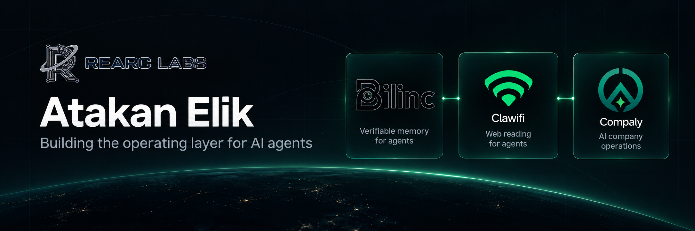

<div align="center">
  
</div>

<br />

<div align="center">

[](https://rearclabs.com)
[](https://www.python.org/)
[](https://www.typescriptlang.org/)
[](https://modelcontextprotocol.io/)

</div>

## Building the operating layer for autonomous agents

I'm Atakan Elik, founder of **ReARC Labs**. I build infrastructure for agents that need to remember, read the web, and keep state that people can inspect.

The thesis is simple: capable agents need more than model calls. They need durable, verifiable memory, reliable access to the web, and records that humans can check and roll back.

<table>
<tr>
<td width="50%" valign="top">

### Bilinc

Verifiable memory for AI agents.

- commit, recall and revise agent state
- provenance, snapshots, diff and rollback
- hosted MCP connector, Python SDK and CLI

[Website →](https://bilinc.space) · [GitHub →](https://github.com/atakanelik34/Bilinc) · [PyPI →](https://pypi.org/project/bilinc/)

</td>
<td width="50%" valign="top">

### Clawifi

Web reading for AI agents.

- search the web, fetch and scrape pages and PDFs
- map and crawl sites
- only the passages that answer a question
- remote MCP server, try it without a key

[Website →](https://clawifi.dev) · [GitHub →](https://github.com/atakanelik34/clawifi-mcp) · [PyPI →](https://pypi.org/project/clawifi/)

</td>
</tr>
</table>

## Current focus

```txt
memory layer      Bilinc      durable agent state, recall, provenance, rollback
web layer         Clawifi     search, fetch, crawl, passages that answer, MCP
company layer     Compaly     AI-native company operations (in development)
```

## Product surfaces

- [ReARC Labs](https://rearclabs.com) — the company behind these products
- [Bilinc](https://bilinc.space) — verifiable memory for AI agents
- [Clawifi](https://clawifi.dev) — web reading for AI agents
- [ARES Protocol](https://ares-protocol.xyz) — agent reputation research (paused)

## Stack I keep close

<p>
  
  
  
  
  
  
  
</p>

## Selected public work

<p>
  <a href="https://pepy.tech/projects/bilinc">
    
  </a>
  <a href="https://pypi.org/project/clawifi/">
    
  </a>
  
</p>

<a href="https://github.com/atakanelik34/Bilinc">
  
</a>
<a href="https://github.com/atakanelik34/clawifi-mcp">
  
</a>

<br />
<br />

<div align="center">
  
</div>

---

<div align="center">
  <sub>Agents should leave receipts. Systems should stay inspectable.</sub>
</div>
